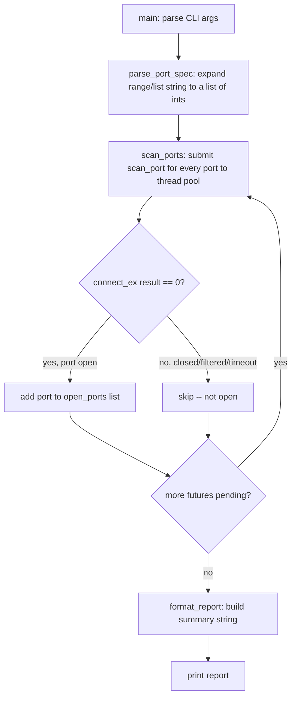

# Week 8: Local Port Scanner — Walkthrough

## (a) How you'd get there

The first question to ask isn't "how do I open a socket" — it's **"what does
one unit of work look like, and how do I repeat it fast?"** One unit of work
is: try to connect to one port, find out if it's open. Everything else
(looping over a range, going fast, printing a report) is built on top of that
one function.

Why `connect_ex()` instead of a `try: sock.connect() / except ConnectionRefusedError`?
Both work, but `connect_ex()` returns an error code instead of raising, which
keeps the per-port check a single clean expression (`result == 0`) rather than
a try/except for what is, on a scan, an *expected, routine* outcome (most
ports will be closed). Exceptions are for exceptional things; "this port is
closed" happens hundreds of times per scan, so a return-code check reads more
honestly than a try/except wrapped around an expected failure.

A naive first attempt almost always snags on **timeouts**. If you forget
`sock.settimeout(timeout)`, scanning even 1-1024 on a *filtered* (not
closed-but-refused, just silently dropped) host can take the OS default
timeout per port — which can be minutes, not seconds — making a "quick" scan
of 1000 ports appear to hang forever. The fix is one line, but you only
discover you need it by watching a scan stall and asking "why is this taking
so long" rather than assuming the socket call itself is slow.

The second thing to notice: scanning is **I/O-bound waiting**, not CPU work.
Each `connect()` call mostly just sits there waiting for a response (or a
timeout). That's exactly the case `ThreadPoolExecutor` is for — threads don't
help CPU-bound work (the GIL gets in the way) but they're great when a
function spends its time blocked on the network.

## (b) Hand-traced example

Input: `scan_ports("127.0.0.1", [22, 80, 9999], timeout=0.5, max_workers=10)`
on a machine where only port 22 (SSH) is actually listening.

| Step | What happens | Key variable state |
|---|---|---|
| 1 | `scan_ports` builds a thread pool and submits 3 futures | `future_to_port = {<Future22>: 22, <Future80>: 80, <Future9999>: 9999}` |
| 2 | Each future runs `scan_port(host, port, 0.5)` concurrently | three sockets opened in parallel |
| 3 | `scan_port(127.0.0.1, 22, 0.5)` → `connect_ex` returns `0` (success) | returns `True` |
| 4 | `scan_port(127.0.0.1, 80, 0.5)` → OS actively refuses → `connect_ex` returns a nonzero errno immediately | returns `False` |
| 5 | `scan_port(127.0.0.1, 9999, 0.5)` → nothing listening and nothing refusing → socket waits the full 0.5s, then times out | returns `False` |
| 6 | `as_completed()` yields futures as they finish (order not guaranteed — port 80 and 9999 likely finish before/around port 22 depending on OS refusal speed) | `open_ports` appended to only when `future.result()` is `True` |
| 7 | After all 3 futures resolve | `open_ports = [22]` |
| 8 | `sorted(open_ports)` | `[22]` (already sorted, but defensive) |
| 9 | `format_report("127.0.0.1", [22])` | builds the "Open ports on 127.0.0.1: 22/tcp open ssh ..." string |

The detail worth noticing: port 9999 (silently dropped) takes the *full*
timeout, while port 80 (actively refused) returns almost instantly. That
asymmetry is exactly why `timeout` has to be a deliberate, tunable parameter
rather than a hardcoded "small number" — too short and you'll report filtered
ports as closed when they might just be slow to refuse; too long and a scan
of a mostly-filtered range crawls.

## (c) Key new library/pattern + common mistakes

**New pattern:** `concurrent.futures.ThreadPoolExecutor` + `as_completed()` for
"fan out N independent I/O calls, collect results as they arrive." This is a
pattern you'll reuse constantly in security tooling — it's the same shape
you'd use to check a list of URLs, query several hosts, or hit several API
endpoints concurrently.

**Common mistakes:**
- **Forgetting `settimeout()`** — covered above; turns a fast scan into a slow
  one on filtered hosts.
- **Using `sock.connect()` without a `with` block** — leaks the socket file
  descriptor if an exception occurs partway through; `with socket.socket(...) as sock:`
  guarantees cleanup even on error.
- **Scanning anything other than localhost/your own LAN** — port scanning
  hosts you don't own or have explicit permission to test is a legal and
  ethical line, not just a style preference. Keep this tool pointed at
  `127.0.0.1` or machines you control.
- **Unbounded thread counts** — `max_workers=100` isn't arbitrary; spinning up
  one thread *per port* on a 1-65535 scan would create tens of thousands of
  threads and likely exhaust OS resources. A bounded pool reuses a fixed
  number of worker threads across all the submitted work.

## (d) Reference flowchart

Since week 8 (the week this solution covers) was required to include a
Mermaid planning flowchart, here's a reference diagram for comparison against
your own — not to replace it, but to check your plan caught the same branches:

