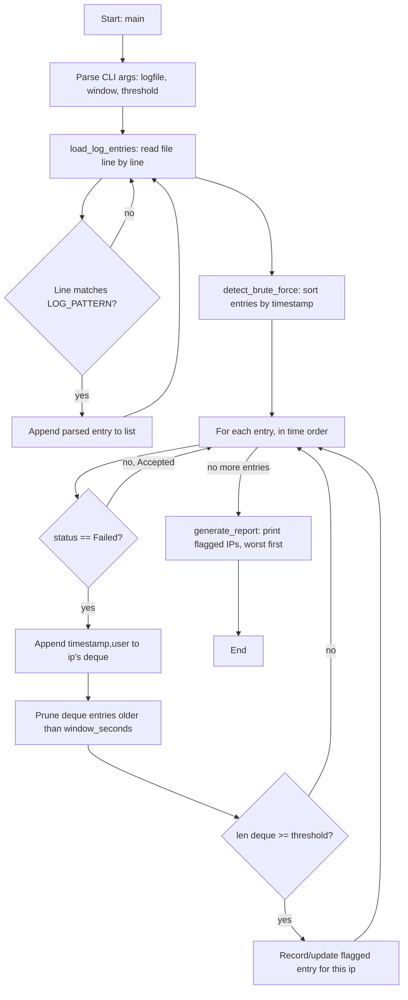

# Week 9 Solution Walkthrough — Brute-Force Log Analyzer

## (a) How you'd get there — the thought process

**First question to ask:** "What does 'the same IP within a rolling window' actually require me to track, and when do I check it?" That's the crux of this challenge — not the regex, the windowing.

A naive first instinct is: count total failures per IP across the whole file, and flag any IP over some count. That's simpler to write, but it's wrong for the stated requirement — 20 failures spread evenly across 6 hours is not a brute-force pattern, but 5 failures in 10 seconds is, and a flat total-count approach can't tell those apart. The moment you reread "within a rolling window" you should feel that snag: *a single running counter isn't enough — I need a counter that forgets old events.* That's the tell that you need a sliding window, not a tally.

Given that, the next question is: "what data structure forgets old events cheaply?" A plain list would work (append, then filter out anything too old), but filtering a list means rebuilding it every time — `O(n)` per entry. A `deque` lets you pop expired entries off the *left* end in O(1) each, because the entries are already in time order (oldest arrives first), so the oldest is always at index 0. That's the whole reason `collections.deque` shows up here instead of a list — recognizing "I only ever remove from one end, in order" is what should point you at `deque` rather than reaching for it by habit.

One more snag a naive version hits: what happens when an IP finally succeeds after several failures? The instinct might be "the attack is over, clear its record" — but that's backwards. A successful login after 4 failed guesses, immediately followed by a 5th failure from the same window, is *still* a brute-force pattern (maybe the attacker found one valid password and kept trying others). So successes are intentionally ignored rather than used to reset state — only time (falling out of the window) ages old failures out.

Last structural decision: should the report include the *worst* window an IP produced, or just the *last* one checked? If you naively overwrite the stored record every time an IP is above threshold, a brief later lull (failures just barely under threshold) could make the final reported count look smaller than what actually happened. The solution guards against that by only updating the stored record when the new window's count is greater-or-equal to what's already stored.

## (b) Hand-traced example

Using `--window 60 --threshold 5` and this slice of log data (already chronological):

| time     | ip             | status | user  |
|----------|----------------|--------|-------|
| 03:14:40 | 203.0.113.50   | Failed | admin |
| 03:14:45 | 203.0.113.50   | Failed | root  |
| 03:14:50 | 203.0.113.50   | Failed | test  |
| 03:14:55 | 203.0.113.50   | Failed | root  |
| 03:15:00 | 203.0.113.50   | Failed | admin |
| 03:15:05 | 192.168.1.10   | Accepted | paul |

Tracing `recent_failures["203.0.113.50"]` (a deque of `(timestamp, user)`) after each failed line:

```
after 03:14:40 -> deque([(03:14:40, admin)])                         len=1
after 03:14:45 -> deque([(03:14:40, admin), (03:14:45, root)])        len=2
after 03:14:50 -> deque([...admin, root, (03:14:50, test)])           len=3
after 03:14:55 -> deque([...admin, root, test, (03:14:55, root)])     len=4
after 03:15:00 -> deque([...admin, root, test, root, (03:15:00, admin)])  len=5
```

At 03:15:00, cutoff = `03:15:00 - 60s = 03:14:00`. Nothing in the deque is older than that, so nothing is pruned, and `len(window) == 5 >= threshold (5)` — this IP is now flagged.

`flagged["203.0.113.50"]` becomes:
```python
{
    "failure_count": 5,
    "first_seen": datetime(..., 03, 14, 40),   # window[0][0]
    "last_seen":  datetime(..., 03, 15, 00),   # window[-1][0]
    "users_tried": {"admin", "root", "test"},
}
```

The 03:15:05 `Accepted` line is skipped entirely (`status != "Failed"`) — it neither feeds the window nor clears it.

## (c) Key new library/pattern, and common mistakes

**New pattern:** a rolling/sliding time window implemented with `collections.deque`, pruned from the left as new events arrive. This generalizes well beyond brute-force detection — it's the same shape you'd use for rate limiting, "alerts per minute" dashboards, or any "N events in the last T seconds" rule.

**Common mistakes this challenge is designed to catch:**

1. **Counting totals instead of windowing.** Easy to write, wrong semantics — flags "frequent" IPs instead of "bursty" ones.
2. **Assuming the log is sorted and never checking.** A log file assembled from multiple sources (or rotated/concatenated) might not be in strict time order; sorting defensively before the windowing logic runs is cheap insurance.
3. **Treating a success as a reason to reset the window.** It's tempting, but it throws away a real signal (a compromised-then-continued-probing account).
4. **Re-scanning the whole history on every event** instead of trimming from the front of a deque — works fine on a sample file, but turns quadratic on a real multi-megabyte log.
5. **The year-less timestamp trap**: `auth.log` lines don't carry a year, so parsing requires *assuming* one (here, the current year). It's a known, called-out limit of this toy format — worth noticing rather than quietly baking in, since it would misorder entries spanning a New Year boundary on a long-lived real log.

## (d) Reference flowchart for this week's solution

This is the kind of diagram worth sketching in "Plan It First" *before* writing the code above — note how it mirrors the function boundaries (`load_log_entries`, `detect_brute_force`, `generate_report`) almost one-to-one, which is exactly the point of planning this way.


