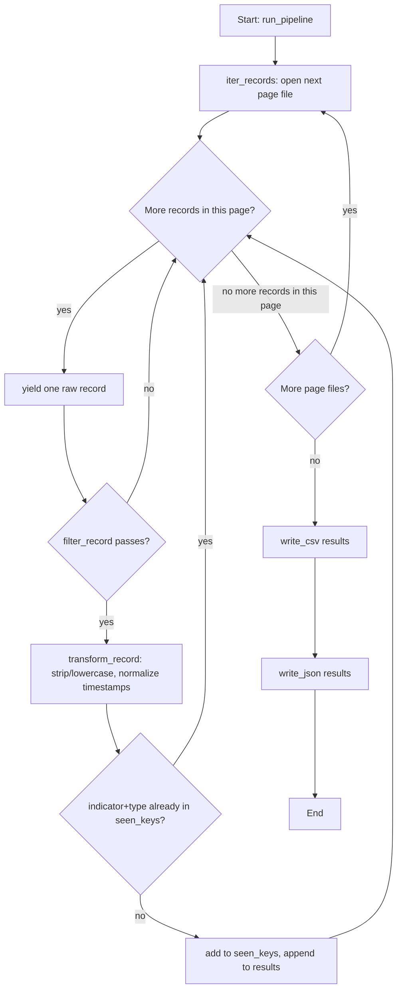

# Week 10 Explanation -- IOC Feed ETL Pipeline

## (a) How you'd get there -- the thought process

The first question to ask isn't "how do I parse JSON" -- you already know
that. It's: **"how much data am I dealing with, and can I afford to hold
all of it in memory at once?"** The challenge spells it out directly: this
is meant to simulate a paginated API, and the whole point of pagination is
that the provider refuses to hand you everything at once. If your code's
first move is `all_pages = [json.load(open(f)) for f in files]`, you've
quietly defeated the one constraint that makes this exercise realistic.
That's the naive first attempt almost everyone reaches for -- load
everything into one big list, then filter/transform/dedupe on the list.
It'll work fine on 3 tiny sample pages. It falls over the moment "pages"
means 500 files of 10,000 records each. The tell that you've snagged on
this: if you can't describe your read step as "yields one record, then
moves on" -- if the whole feed has to exist in a variable before step 2
can start -- you've built a loader, not a generator.

The fix is to reach for a **generator**: a function that `yield`s one
record at a time instead of `return`ing a list. `iter_records()` still
loads one *page* fully (that's fine -- a single page is small by
definition), but it never needs page 2 to exist while it's still handing
you records from page 1. The caller (`run_pipeline`) just does a `for raw
in iter_records(directory):` loop and never notices the difference between
"the whole feed is in memory" and "records are arriving one at a time" --
which is exactly the point. This is the same shape you'll use again when
reading really large log files, or paging through *any* API (including
`boto3`'s own paginators later in the series).

Why a `set` of `(indicator, type)` tuples for dedupe, rather than, say,
checking `if record not in results` against the growing output list? Two
reasons: membership testing against a Python `list` is O(n) per check (it
scans the whole list every time), so dedupe cost grows quadratically as
the feed grows. A `set` lookup is O(1). Second, "duplicate" here doesn't
mean "identical dict" -- the planted duplicate in the sample data has
different casing and a different `source` field. Defining the dedupe key
explicitly (`indicator.lower()` + `type`) as a tuple is how you decide
*what counts as the same IOC* instead of leaving it to accidental dict
equality.

The other naive snag: timestamps. A real vendor feed will absolutely hand
you more than one timestamp format across different records (one API
version vs. another, different source feeds, etc.). Writing
`datetime.strptime(ts, "%Y-%m-%dT%H:%M:%SZ")` and assuming it always works
is the kind of thing that passes on your 3 sample pages and then raises
`ValueError` the first time it meets a real feed. `normalize_timestamp()`
tries a short list of known formats and falls back to the raw string
rather than crashing the entire pipeline over one malformed record --
a deliberate design choice: one bad record shouldn't take down the whole
run.

## (b) Hand-traced example

Take this one raw record as it comes out of `iter_records()`:

```python
raw = {
    "indicator": " 185.220.101.5 ",
    "type": "ip",
    "severity": 7,
    "first_seen": "2026-09-01T10:15:00Z",
    "last_seen": "2026-10-15 03:22:10",
    "source": "feedA",
}
```

**Step 1 -- `filter_record(raw, min_severity=5)`**
`severity` is `7 >= 5` -> True. `type` is `"ip"`, which is in
`ALLOWED_TYPES`. `indicator.strip()` is non-empty. All three conditions
pass -> record is kept.

**Step 2 -- `transform_record(raw)`**

| field | before | after |
|---|---|---|
| indicator | `" 185.220.101.5 "` | `"185.220.101.5"` (stripped + lowercased) |
| type | `"ip"` | `"ip"` (unchanged) |
| severity | `7` | `7` (unchanged) |
| first_seen | `"2026-09-01T10:15:00Z"` | matches format `%Y-%m-%dT%H:%M:%SZ` -> `"2026-09-01T10:15:00+00:00"` |
| last_seen | `"2026-10-15 03:22:10"` | first format fails, second format `%Y-%m-%d %H:%M:%S` matches -> `"2026-10-15T03:22:10+00:00"` |
| source | `"feedA"` | `"feedA"` (unchanged) |

Result:

```python
clean = {
    "indicator": "185.220.101.5",
    "type": "ip",
    "severity": 7,
    "first_seen": "2026-09-01T10:15:00+00:00",
    "last_seen": "2026-10-15T03:22:10+00:00",
    "source": "feedA",
}
```

**Step 3 -- dedupe check in `run_pipeline`**
`dedupe_key = ("185.220.101.5", "ip")`. If this exact key hasn't been seen
yet this run, it's added to `seen_keys` and `clean` is appended to
`results`.

**Step 4a -- `write_csv([clean, ...], "ioc_feed_clean.csv")`**
`csv.DictWriter` writes a header row (`indicator,type,severity,first_seen,last_seen,source`)
followed by this record as:

```
185.220.101.5,ip,7,2026-09-01T10:15:00+00:00,2026-10-15T03:22:10+00:00,feedA
```

**Step 4b -- `write_json([clean, ...], "ioc_feed_clean.json")`**
`json.dump` writes the same record as one element of a JSON array:

```json
{
  "indicator": "185.220.101.5",
  "type": "ip",
  "severity": 7,
  "first_seen": "2026-09-01T10:15:00+00:00",
  "last_seen": "2026-10-15T03:22:10+00:00",
  "source": "feedA"
}
```

Same cleaned record, two formats, zero duplicated logic -- the filter and
transform steps run exactly once, and both writers just consume the
already-clean `results` list.

## (c) Key new library/pattern + common mistakes

**New patterns this week:** generators/iterators for memory-safe chunked
processing (`yield` instead of building and returning a list); `csv`
(specifically `csv.DictWriter`, which maps dicts to rows by field name
instead of you tracking column order by hand); `json.dump`/`json.load`;
and the read -> filter -> transform -> write shape as a named, reusable
pattern rather than one tangled function.

**Common mistakes to avoid:**

- **Loading the whole feed into a list "just to be safe," then filtering
  the list.** This quietly throws away the entire memory-safety point of
  the exercise. If you can `len()` the whole feed before you've filtered
  anything, you've already lost the generator property.
- **Forgetting `newline=""` when opening a CSV file for writing.** On
  Windows (and sometimes elsewhere), `csv.writer`/`csv.DictWriter` will
  add its own line endings; without `newline=""` you can end up with
  blank rows between every real row.
- **Assuming one timestamp format.** A single `strptime()` call with no
  fallback will crash the entire pipeline on the first record that
  doesn't match -- and real feeds are never that uniform.
- **Deduping on the raw dict instead of a deliberate key.** `" 185.220.101.5 "`
  and `"185.220.101.5"` are different strings; if you don't strip/lowercase
  *before* building your dedupe key, "duplicates" slip through.
- **Mixing concerns inside one giant function.** It's tempting to filter,
  transform, and check for duplicates all inline inside the loop. Keeping
  `filter_record`, `transform_record`, and the dedupe check as separate,
  individually testable steps is exactly what makes `weekNN_test.py`
  able to test each piece in isolation.

## (d) Reference flowchart for Week 10's solution

This is what the plan behind `run_pipeline()` looks like as a flowchart --
useful to compare against whatever you sketched for your own attempt
before you started coding:


